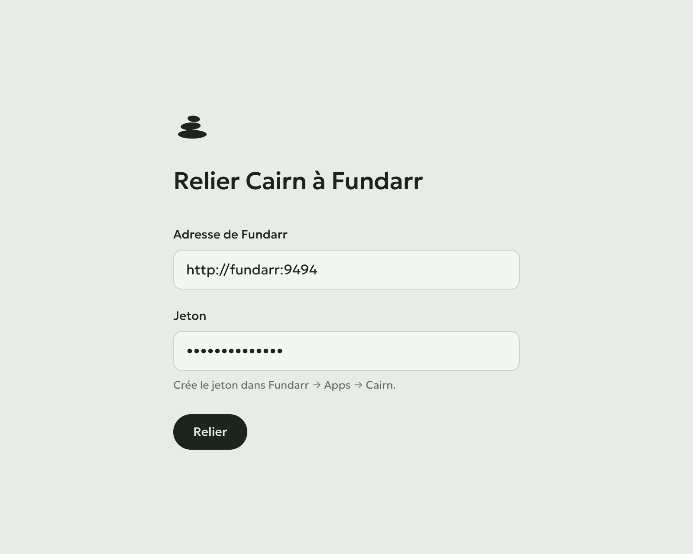

# Cairn

Where my crypto stands: total value, what I put in, what it became, and the lines of the French 2086 tax form. A small personal app that reads everything from [Fundarr](https://github.com/Alexis-Marcel/fundarr)'s read API; it keeps only the link to it.


- **Accueil**: value, invested, gain; value against invested over time (1M, 1A, Tout); allocation by asset or platform; each asset; this month's money in and rewards.
- **Impôts**: one year of disposals as 2086 lines, totals, estimated tax, a CSV to copy into the form. Rewards can be counted as already taxed income.

One Go binary serves the UI and forwards its reads to Fundarr with the token, which never reaches the browser. Answers are cached for a minute.

**Cairn has no sign-in of its own.** Keep it on localhost, or put it behind a reverse proxy that signs you in (Authentik, Authelia, oauth2-proxy…). Never straight on the internet: whoever opens it sees the portfolio, and can relink it.

## Run with Docker

```sh
docker run -d --name cairn -p 127.0.0.1:8080:8080 -v cairn:/data ghcr.io/alexis-marcel/cairn
```

or see [`compose.yaml`](compose.yaml). Then:

1. Open Cairn (http://localhost:8080).
2. In Fundarr, create a token: Apps → Cairn.
3. Paste Fundarr's address, as Cairn reaches it (`http://fundarr:9494`), and the token. Relier.



Cairn tries them before keeping them, in `/data/cairn.json` (readable by Cairn alone). Réglages, at the bottom of the page, shows which Fundarr it reads, and changes or removes the link.

With a bind mount (`./data:/data`), the folder must be writable by the image's user: `mkdir -p data && sudo chown 65532:65532 data`.

| Variable | Default | |
|---|---|---|
| `CAIRN_DATA` | `/data` | where the link is kept |
| `CAIRN_ADDR` | `:8080` | address to listen on |
| `CAIRN_CACHE` | `60s` | how long an answer is kept (`0s`: never) |
| `FUNDARR_URL` | | Fundarr's address; fixes the link, no page to change it |
| `FUNDARR_TOKEN` | | Fundarr read token (`fdr_…`), with `FUNDARR_URL` |

`/healthz` answers `ok`. Only `GET` reaches Fundarr; Fundarr's errors come back as `{"error": "…"}`. `/api/setup` reads the link (`GET`), sets it (`POST {"url", "token"}`) or removes it (`DELETE`); writes must be JSON from Cairn's own page.

## Develop

Go 1.26 and Node 24. `fakefundarr` answers like Fundarr with a made-up portfolio (2023 to today, BTC, ETH, SOL, ADA, USDT, three platforms, sales every year):

```sh
go run ./cmd/fakefundarr                       # :9494, token fdr_dev
CAIRN_DATA=./data go run ./cmd/cairn           # :8080, link it to http://localhost:9494 with fdr_dev
cd web && npm install && npm run dev           # http://localhost:5173
```

Fundarr's own demo works too: `FUNDARR_DEMO=1` makes it answer with sample data and accept the token `fdr_demo`. To skip the page, set `FUNDARR_URL` and `FUNDARR_TOKEN` instead of `CAIRN_DATA`.

`go test ./...` and `npm run build` (typecheck included) are what CI runs. `go build ./cmd/cairn` after `npm run build` gives the binary with the UI inside.

## Credits

Coin icons: [cryptocurrency-icons](https://github.com/spothq/cryptocurrency-icons), CC0. Typeface: [Geologica](https://fonts.google.com/specimen/Geologica), OFL.

## Licence

AGPL-3.0. Voir [LICENSE](LICENSE).
