# Cairn

Where my investments stand, crypto, stocks and ETFs: what they are worth, what I put in, what they became, and how. A small, opinionated personal app: you give it your operations, it does the rest.

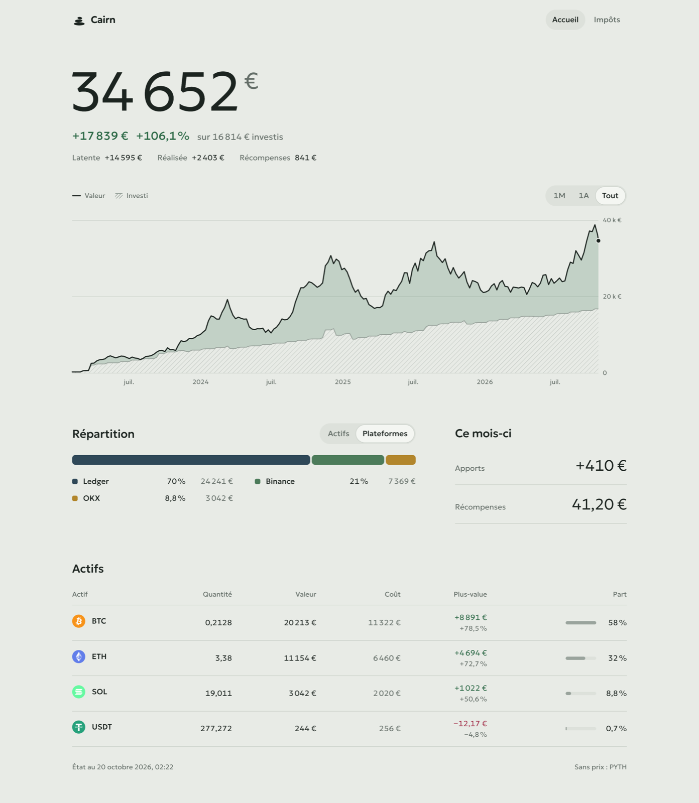

- **Tout, Crypto, Bourse**: one switch above the value (shown when there are both) narrows every figure, chart, list and the activity to crypto alone or to stocks and ETFs alone, and stays on from page to page. Each side is counted as a portfolio of its own, with the cash of its accounts: an exchange's euros go with Crypto, a broker's with Bourse, a manual account with the class it trades most. Euros sent from an exchange to a broker leave Crypto and enter Bourse (Tout sees nothing move); the two sides add up to Tout.
- **Accueil**: the value and its change over 7J, 1M, YTD, 1A or Tout, in euros and as a share of what was at stake (the opening value plus money put in since); a chart to scrub with a finger (value against money put in, or performance time-weighted so deposits are not gains); gain, yearly return (money-weighted), net contributions, income (staking, dividends, interest), fees; each asset with its month, and the cash; allocation by asset, by class (crypto, ETF, stocks, stablecoins, cash) or by account.
- **Statistiques** (on Accueil): monthly returns year by year, money put in and taken out each month ("Ce mois-ci : versé 2 000 € · retiré 1 741 € · net +259 €"), cumulative income, what came from contributions, income and the market, gain by asset.
- **Actifs**: every coin, stock and ETF, held or sold, by name (a security's ISIN is a detail on its page), and each account's cash (Liquidités); a long list can be searched and sorted by value, gain or name. One page each: its price with my average cost and my buys and sales, the quantity held, unrealized and realized gain, rewards or dividends, fees, its operations.
- **Activité**: every operation by month, by account or asset, searchable by name, loading as you scroll. Add (**N** on a keyboard; from an asset's page, for that asset), change or remove those entered by hand or imported.
- **Stratégie**: what to do now, the model portfolio, where the next euros go. The model is a list of assets, each with the account it is bought on and its share of everything invested, changed in place (or started from what you hold); what is held outside it still counts in the crypto/bourse split but receives no more money, and can be marked to sell. What to do lists the moves that cost no tax first (swapping coins, arbitrages inside a PEA), then the cash to place, the sales asked for with their tax, crypto out of its band, coins to take home to your wallet; each goes away once done. On Accueil, a goal with its projection (2, 5 and 8 % a year) and the monthly plan, a crisis test, concentration and custody; on Impôts, the year, the PEA's five years, a crypto sale's tax, the securities account, fees and the platforms abroad to declare (3916, 3916-bis). Illustrations, not advice.
- **Impôts** (a card on Accueil when a declaration has something, and in the footer): one year of crypto disposals as 2086 lines, totals, estimated tax, a CSV to copy into the form. Stocks and ETFs are left out.

**How the figures count.** The portfolio is everything on its accounts, cash included: euros sitting on an exchange or at a broker are part of the value, as Liquidités, worked out from the history (a trade's cash, deposits, withdrawals, fees, interest, dividends). Money counts as put in when it comes from outside (a bank transfer in, a card top-up) and as taken out when it leaves (a bank transfer out, a card payment, a cash withdrawal): selling for euros takes nothing out, the euros stay. Card spending is money taken out, never a loss. Coins received from or sent to a wallet that is not one of the accounts (no matching deposit) count the same way, at their value ("Envoi externe" in Activité). A purchase with no euros on the account before it (typed by hand, without the deposit) was paid from outside: the shortfall is money put in. Dividends and interest stay on the account: income, part of the gain, the yearly return and the time-weighted performance. Stablecoins are crypto.

Fundarr's balance corrections ("Ajustement" in Activité), made when a platform's history does not add up to what it holds, are neither money put in nor gains: performance treats them as external, so they make no gain or loss, and they are shown apart, in one quiet line ("Ajustements Fundarr −2 920 €"). Importing the platform's statement in Fundarr replaces them with the real operations. Everything is computed again from the history, so a new Cairn recounts an old database as it is. A broker's accounts from Fundarr stay apart (Trade Republic CTO and PEA).

One Go binary serves the UI, keeps everything in SQLite (`/data/cairn.db`) and computes the portfolio itself, with [Fundarr](https://github.com/Alexis-Marcel/fundarr)'s engine as a library (average cost per account, transfers carrying their cost, the 2086 method). Daily prices come from Binance and OKX public market data for crypto, justETF (Yahoo Finance as a fallback) for stocks and ETFs by ISIN, and the ECB's rates (through Frankfurter): no key, no account, each day asked once and kept. A security no source knows is valued at its last trade.

**Cairn has no sign-in of its own.** Keep it on localhost, or put it behind a reverse proxy that signs you in (Authentik, Authelia, oauth2-proxy…). Never straight on the internet: whoever opens it sees and edits the portfolio.

## Run with Docker

```sh
docker run -d --name cairn -p 127.0.0.1:8080:8080 -v cairn:/data ghcr.io/alexis-marcel/cairn
```

or see [`compose.yaml`](compose.yaml), then open http://localhost:8080. With a bind mount (`./data:/data`), the folder must be writable by the image's user: `mkdir -p data && sudo chown 65532:65532 data`.

## Three ways to feed it

Cairn opens on an empty Accueil that offers all three; they mix freely.

1. **By hand**: Ajouter. Achat, vente, échange, dépôt, retrait, récompense, dividende, transfert entre comptes, frais. A date, an account (or a new one), a coin or a stock or ETF (by name, or by its ISIN, checked, with its name the first time), a quantity; the price of a purchase or a sale is filled in from the day's close.
2. **A CSV file**: Activité → Importer. Each row is checked and shown before anything is added; importing the same file again adds nothing.
3. **Fundarr** (optional): Réglages → Synchroniser avec Fundarr. Cairn keeps a copy of Fundarr's history through its [changes feed](https://github.com/Alexis-Marcel/fundarr/blob/main/docs/api.md#get-apiv1changes), every 15 minutes, one account per Fundarr source. Those operations are read-only in Cairn: change them in Fundarr.

### Fundarr

In Fundarr, **Apps → Add app → Cairn** gives a token. In Cairn, Réglages: paste the token; the address fills in by itself when Fundarr runs next to Cairn (`http://fundarr:9494` on a shared Docker network). Use that internal address rather than a public one, which a proxy may block. Cairn tries them, then copies the history. **Délier** asks whether to keep the copied operations (they become editable) or remove them.

To be told of changes instead of waiting for the next 15 minutes: Réglages → *Être prévenu par Fundarr* shows Cairn's notify address (`https://cairn.example/api/fundarr/notify`). Give it to Fundarr (**Apps → Cairn → Notify**), then paste the secret Fundarr shows once into Cairn. Fundarr signs each call with it (`Fundarr-Signature`, HMAC-SHA256 of `<t>.<body>`, checked to be recent); without a secret the route answers 404.

Fundarr must be able to reach that address. Behind a signing-in proxy, **`POST /api/fundarr/notify` is the only route to let through without sign-in**: it changes nothing but asks Cairn to sync, and only with a valid signature. Everything else stays behind the sign-in.

### CSV format

Fundarr's own export (`GET /api/v1/activities.csv?format=fundarr`) is read as is: each row keeps its account (Fundarr's source) and transfers stay paired.

Or Cairn's template, served at `/api/import/modele.csv` (Importer → Télécharger le modèle): one operation per row, commas or semicolons, decimal points or commas, columns in any order.

| Column | |
|---|---|
| `date` | `2024-03-01`, `01/03/2024` or an RFC 3339 time |
| `type` | `achat`, `vente`, `echange`, `depot`, `retrait`, `recompense`, `dividende`, `interets`, `frais` (or `buy`, `sell`, `swap`, `deposit`, `withdrawal`, `reward`, `dividend`, `interest`, `fee`) |
| `actif`, `quantite` | `BTC`, `0,01` (`EUR` for cash deposits and withdrawals) |
| `isin`, `nom` | a stock or an ETF: `IE00B4L5Y983`, `iShares Core MSCI World` (the ISIN may also go in `actif`) |
| `prix` | `achat`, `vente`: the total in euros; `dividende`: the amount received |
| `frais` | in euros, optional |
| `recu`, `quantite_recue` | `echange`: the coin received and how much |
| `compte`, `note` | optional; without `compte`, pick one account for the whole file |

```csv
date,type,actif,quantite,prix,frais,recu,quantite_recue,compte,note,isin,nom
2024-03-01,achat,BTC,0.01,550,1.5,,,Binance,,,
2024-05-10,echange,BTC,0.005,,,ETH,0.08,Binance,,,
2024-06-15,recompense,ETH,0.002,,,,,Binance,staking,,
2024-07-01,achat,,3,300,1,,,Trade Republic,,IE00B4L5Y983,iShares Core MSCI World
2024-12-10,dividende,,,4.2,,,,Trade Republic,,FR0000120271,TotalEnergies
```

## Settings

| Variable | Default | |
|---|---|---|
| `CAIRN_DATA` | `/data` | where `cairn.db` is kept (readable by Cairn alone: it holds the Fundarr token) |
| `CAIRN_ADDR` | `:8080` | address to listen on |
| `CAIRN_CACHE` | `60s` | how long a computed answer is kept while nothing changes (prices move) |
| `FUNDARR_URL` | | Fundarr's address; fixes the link, no page to change it |
| `FUNDARR_TOKEN` | | Fundarr read token (`fdr_…`), with `FUNDARR_URL` |
| `FUNDARR_NOTIFY_SECRET` | | the notify secret, instead of pasting it in Réglages |

The computed reads (`/api/overview`, `/api/stats`, `/api/portfolio`, `/api/portfolio/history`) and `/api/operations` take `?scope=all|crypto|securities`. `/healthz` answers `ok`. Writes under `/api` must be JSON sent by Cairn's own page (cross-origin protection); errors come back as `{"error": "…"}`. An earlier Cairn's link (`/data/cairn.json`) is moved into the database on first start.

## Develop

Go 1.26 and Node 24. Fundarr's demo gives a made-up portfolio (2023 to today: three crypto sources with rewards, transfers and sales, and Trade Republic with ETFs on a CTO and a PEA, a stock and its dividends) to sync from; run it from a Fundarr clone (v0.2.0 or later):

```sh
FUNDARR_DEMO=1 FUNDARR_ADDR=127.0.0.1:9599 go run ./cmd/fundarr   # in fundarr/, token fdr_demo
CAIRN_DATA=./data go run ./cmd/cairn                               # :8080; Réglages → http://127.0.0.1:9599, fdr_demo
cd web && npm install && npm run dev                               # http://localhost:5173
```

`gofmt`, `go vet ./...`, `go test -race ./...` and `npm run build` (typecheck included) are what CI runs. `go build ./cmd/cairn` after `npm run build` gives the binary with the UI inside.

| | |
|---|---|
| 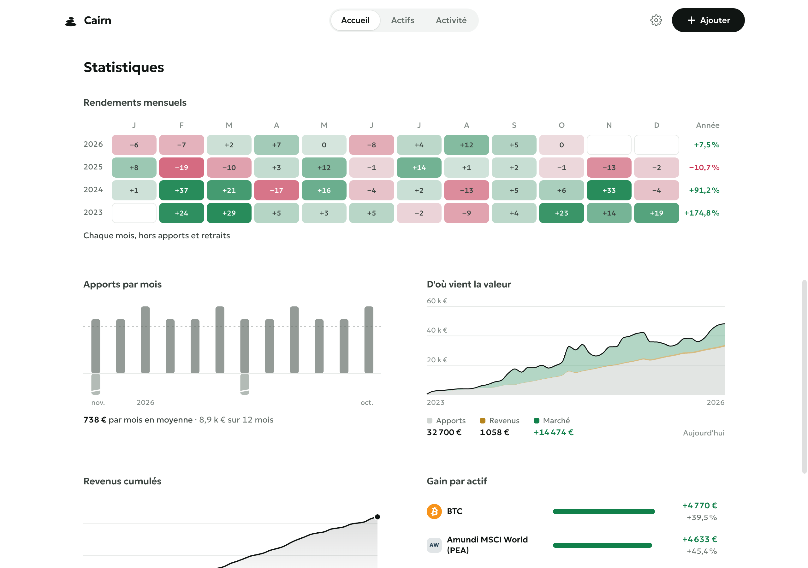 | 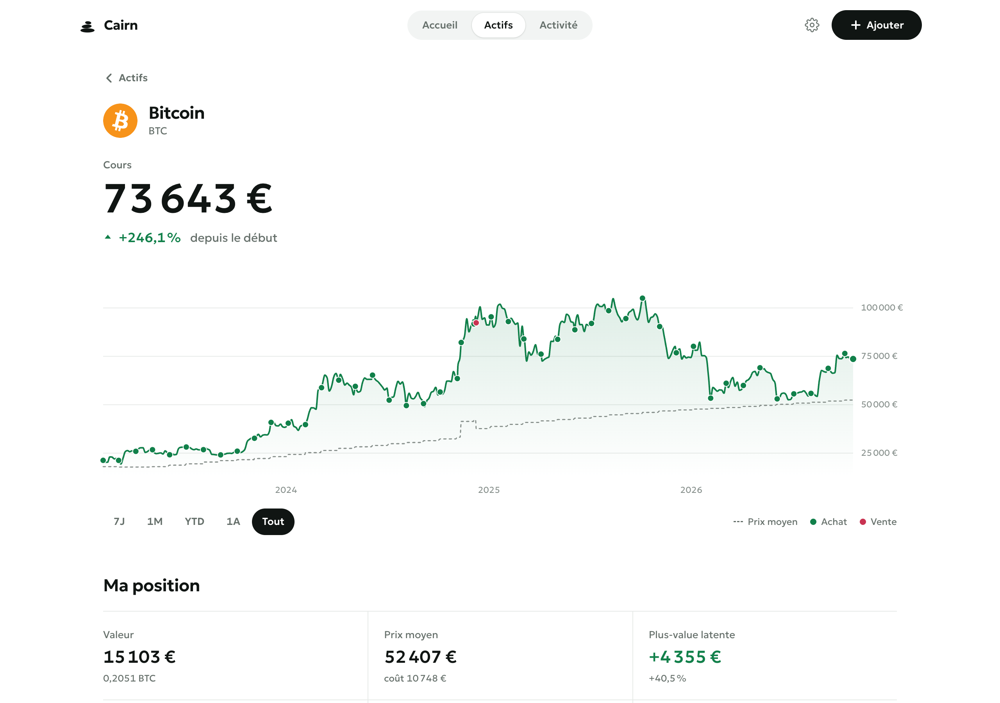 |
| 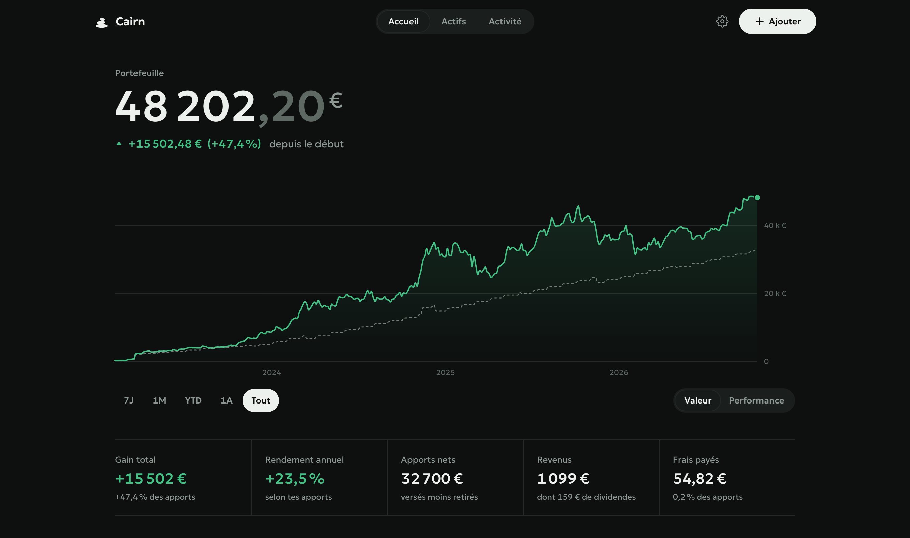 | 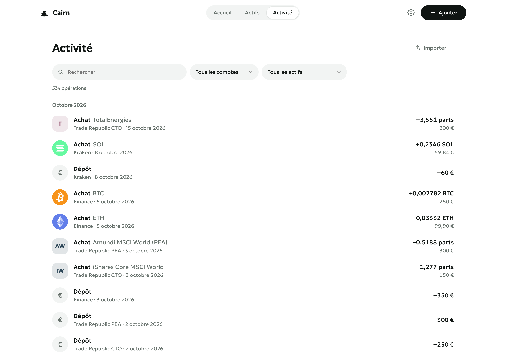 |
| 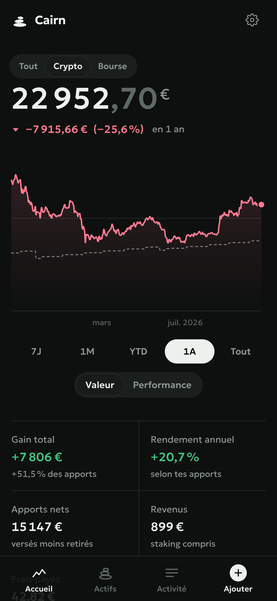 | 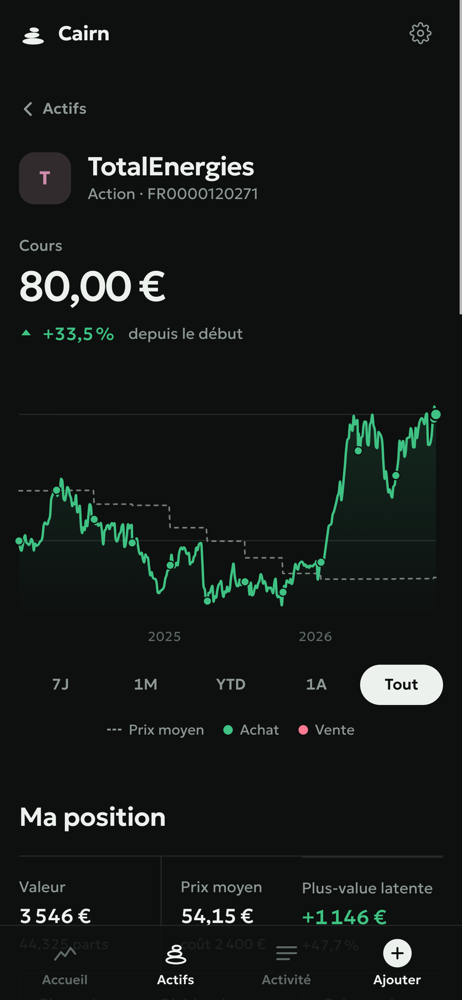 |
| 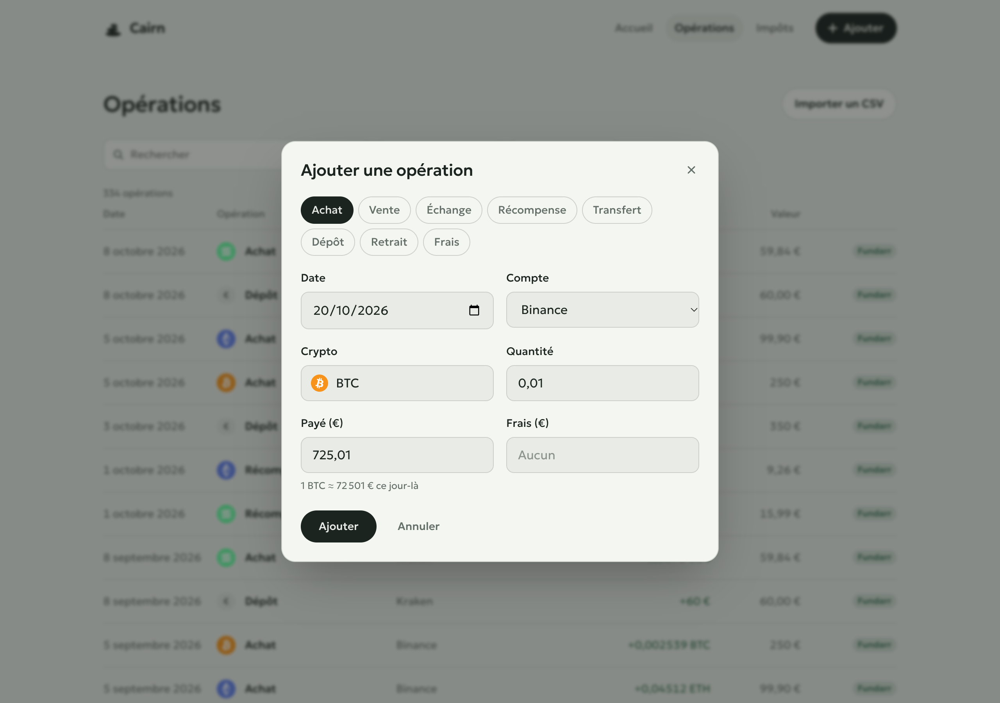 | 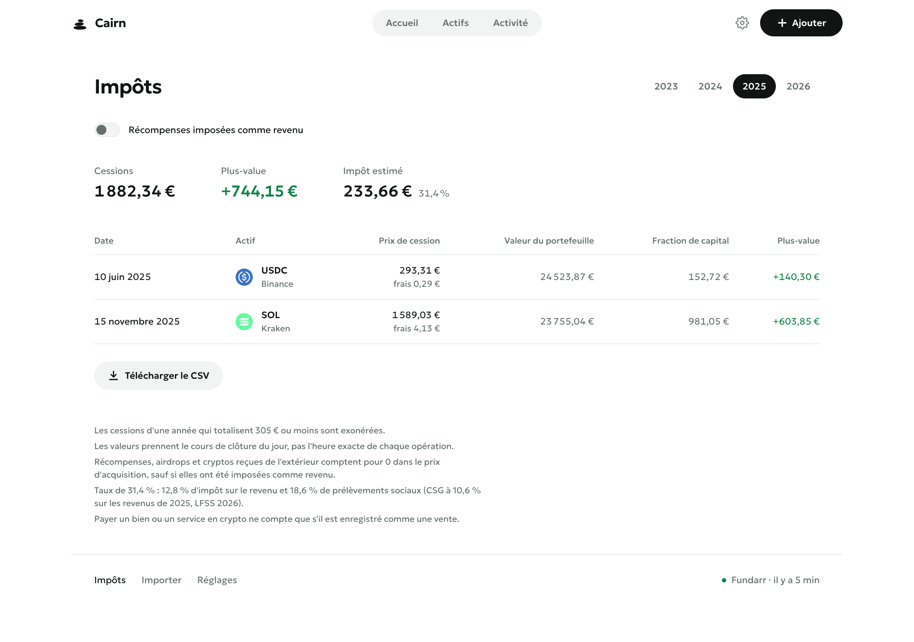 |
| 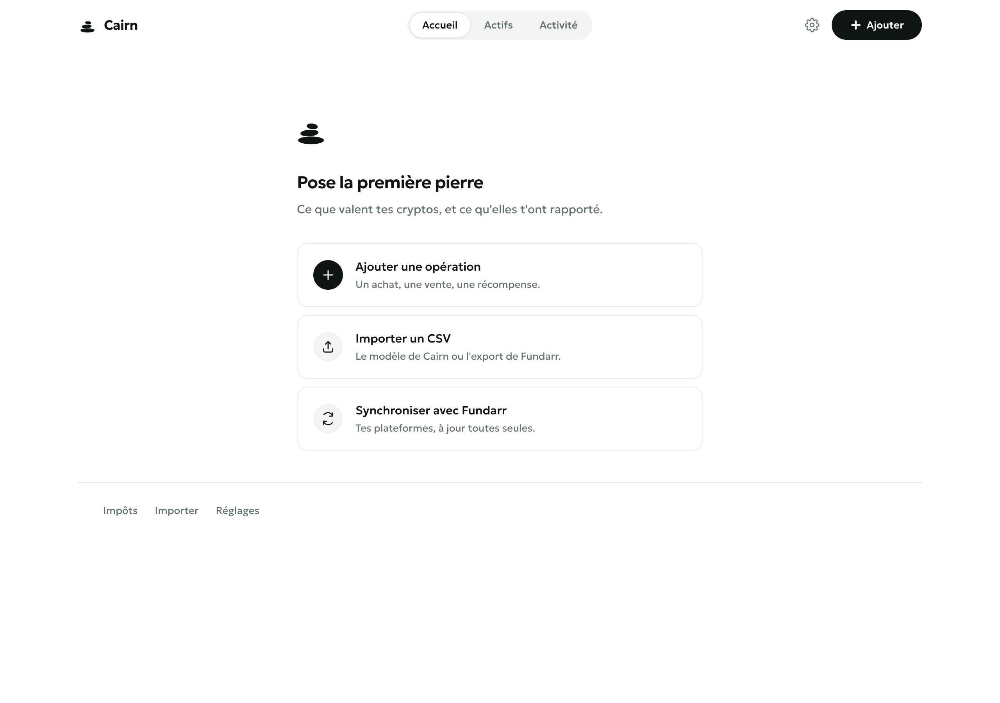 | 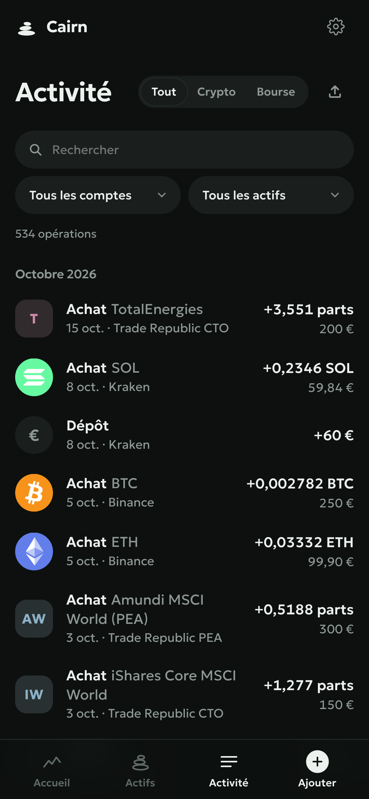 |

## Credits

Coin icons: [cryptocurrency-icons](https://github.com/spothq/cryptocurrency-icons), CC0. Typeface: [Geologica](https://fonts.google.com/specimen/Geologica), OFL. Portfolio engine and prices: [Fundarr](https://github.com/Alexis-Marcel/fundarr)'s `pkg/`, AGPL-3.0.

## Licence

AGPL-3.0. Voir [LICENSE](LICENSE).
